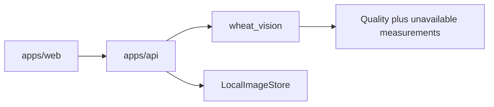

# Architecture

The repository root is the monorepo. An extra `wheat-mvp/` directory would only duplicate the GitHub repository name.

```text
apps/web/          Next.js researcher UI
apps/api/          FastAPI process and storage boundary
packages/vision/   Image pipeline, importable without the API
datasets/          Manifests only; pixels stay local
tests/             API, vision, storage, and harness checks
docs/              Product and engineering memory
```



## Boundaries

- `wheat_vision` accepts NumPy RGB images and returns dataclasses. It does not read HTTP, the database, or object storage.
- `wheat_api` decodes uploads, calls the vision package, and will later persist microplots. Routes stay thin.
- `apps/web` renders what the API returns. It does not compute coverage in the browser.
- `LocalImageStore` is the only storage implementation. The `ImageStore` methods are the extension point for S3. No cloud client is included.
- SQLite is the planned local database (`WHEAT_DATABASE_URL` in `.env.example`). Tables start when microplot records exist, in Phase 3. PostgreSQL is a later swap of that URL if concurrent users require it.

## What runs today

| Piece | Behavior |
| --- | --- |
| `GET /health` | Process check |
| `GET /api/v1/capabilities` | Lists each measurement as experimental or unavailable |
| `POST /api/v1/images/quality` | Provisional blur and exposure flags, max 30 MB, stateless |
| `analyze_image` | Quality plus unavailable agronomic fields |
| Web pages `/` and `/approach` | Public Fenia site. The landing names no crop. The technical approach names sunflower and wheat. `/tech` redirects to `/approach`. |

Uploads are not stored yet. Persisting an image without a microplot record would create orphan files.

## Computation

CPU only. One API process is enough. Do not add a queue, a worker service, or a GPU until a measured step cannot finish interactively.

## Configuration the pipeline must accept

Per microplot, not as hard-coded constants: `width_m`, `length_m`, `row_count`, `row_spacing_m`, growth-stage notes, and border description. Unknowns stay null.

## Deployment shape, not built

See `docs/AWS_PLAN.md`. Nothing in this repository creates cloud resources.
